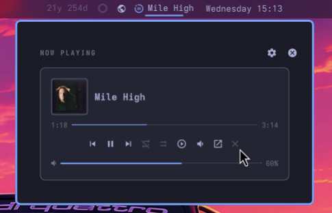
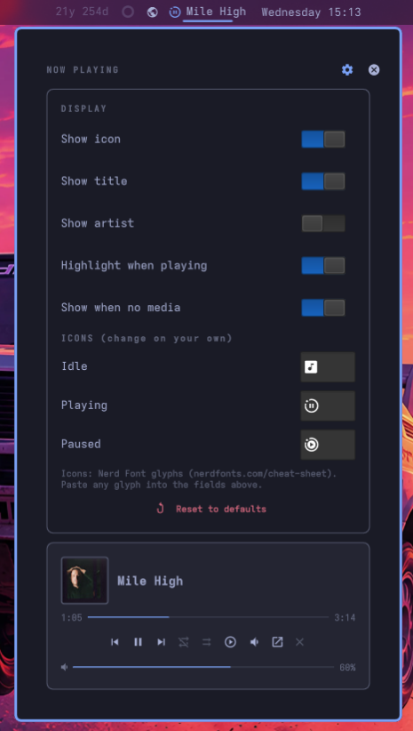

# paudelsamir.nowplaying

minimal, functional now playing for the omarchy bar. shows what's playing, lets you control it.




## what it does

- bar icon + track title (optional artist)
- hover tooltip with title/artist
- left click opens popup, middle click play/pause, wheel switches track
- popup: cover art, seek bar, transport, shuffle, repeat, speed, volume, mute, open app, quit
- settings gear for display/icon toggles + reset to defaults

## install

```bash
omarchy plugin add https://github.com/paudelsamir/nowplaying --enable
```

## settings


edit in shell.json widget entry or via the gear in the popup:

- `showIcon`, `showTitle`, `showArtist`, `highlightPlaying`
- `showWhenNoMedia` (default on)
- `maxTitleLength`, `opacity`
- `idleIcon`, `playingIcon`, `pausedIcon` — any nerd font glyph
